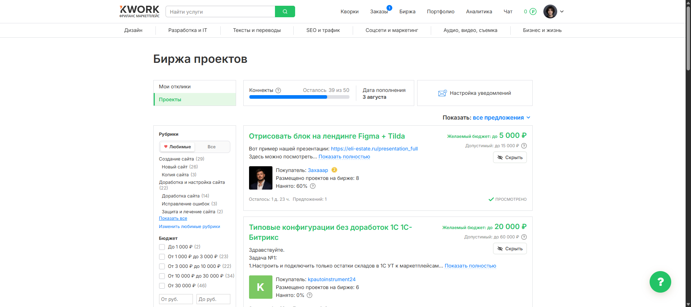

# Kwork — скрытие проектов




Chrome-расширение для биржи [kwork.ru/projects](https://kwork.ru/projects): убирает с ленты ненужные проекты по одному клику и запоминает выбор между сессиями браузера, чтобы не пересматривать одно и то же.

## Возможности

- Кнопка «Скрыть» на каждой карточке проекта.
- Скрытые проекты сохраняются локально и не возвращаются после обновления страницы или перезапуска браузера.
- Отмена последнего действия в течение шести секунд.
- Единая лента вместо пагинации: после короткой паузы безопасный объём страниц тихо собирается в фоне, после чего список обновляется один раз.
- Скрытые проекты не оставляют пустых или разреженных страниц.
- Без индикатора расширения, штатного прелоадера Kwork и последовательных переходов по страницам.
- Быстрые переключения не создают очередь устаревших запросов; для большой выдачи остаются обычные страницы Kwork.
- Кнопка «Извлечь» на карточке складывает заказ на диск отдельной папкой: условия, описание, ссылки и все прикреплённые файлы. Подробности — в [docs/project-export.md](docs/project-export.md).
- Переписки с клиентами сохраняются на диск в markdown и JSON, включая старые сообщения, которые в интерфейсе приходится доскроливать.
- Кнопка «Извлечь все переписки» в значке расширения выгружает все диалоги целиком, с прогрессом и без повторов.
- Сохранённую переписку можно прочитать одной командой — без браузера и входа в аккаунт: `npm run chat -- https://kwork.ru/inbox/<клиент>`. Подробности — в [docs/inbox-export.md](docs/inbox-export.md).

## Установка

1. Откройте в Chrome страницу `chrome://extensions`.
2. Включите «Режим разработчика» в правом верхнем углу.
3. Нажмите «Загрузить распакованное расширение».
4. Выберите папку `kwork-project-hider`.
5. Откройте или обновите `https://kwork.ru/projects`.

Страницы настроек нет: у значка расширения только кнопка выгрузки переписок. Расширение запрашивает доступ к локальному хранилищу Chrome, страницам Kwork, вкладкам и локальному мосту для записи переписок на диск.

Чтобы переписки сохранялись в файлы, один раз запустите `install.bat` и перезапустите Chrome. Без этого шага работает только скрытие проектов.

## Использование

Нажмите «Скрыть» внизу карточки проекта. Карточка исчезнет, а внизу окна появится действие «Отменить». Если отмену не нажать, проект останется скрытым во всех будущих сессиях этого профиля Chrome.

Чтобы выгрузить переписки, нажмите значок расширения и кнопку «Извлечь все переписки». Расширение само откроет страницу переписок, пройдёт по всем диалогам и покажет прогресс; выгрузку можно остановить и продолжить позже. Повторный запуск дополняет уже сохранённые файлы, не создавая дублей.

Каждая переписка получает свою папку: текст диалога, полные данные и подпапка «файлы» со скачанными вложениями и скриншотами. В тексте переписки вложения становятся ссылками на скачанные файлы.

Кнопка «Извлечь» рядом со «Скрыть» складывает заказ в папку `F:\Projects\Kwork\заказы`: заголовок, описание, бюджеты, ссылки на заказ и профиль заказчика, а также все прикреплённые файлы. Когда заказ сохранён, внизу окна появляется действие «Скопировать путь» — путь к папке можно сразу отдать ИИ-агенту.

Расширение ждёт одну секунду после последнего переключения, затем собирает до десяти доступных страниц в фоне и один раз дополняет ленту. Если вы продолжаете менять фильтры или страницы, устаревшая сборка отменяется, а Kwork сразу выполняет последнее действие. Для выдачи больше десяти страниц и при ошибке фоновой сборки остаются обычные номера страниц Kwork.

## Разработка и проверка

```powershell
npm test
powershell -ExecutionPolicy Bypass -File .\scripts\generate-icons.ps1
```

## Технологии

- Chrome Extension Manifest V3 (content scripts, изолированный и MAIN world)
- JavaScript (без сборщика и зависимостей)
- `chrome.storage` для локального сохранения
- Node.js `node --test` для тестов

---

**Автор:** AkashiDevelop (Никита) — веб-разработчик: сайты, Telegram-боты, автоматизация, браузерные расширения, десктоп-приложения.

[Telegram](https://t.me/akashidevelpr) · [Kwork](https://kwork.ru/user/akashidevelop) · [GitHub](https://github.com/feechkablum6)
